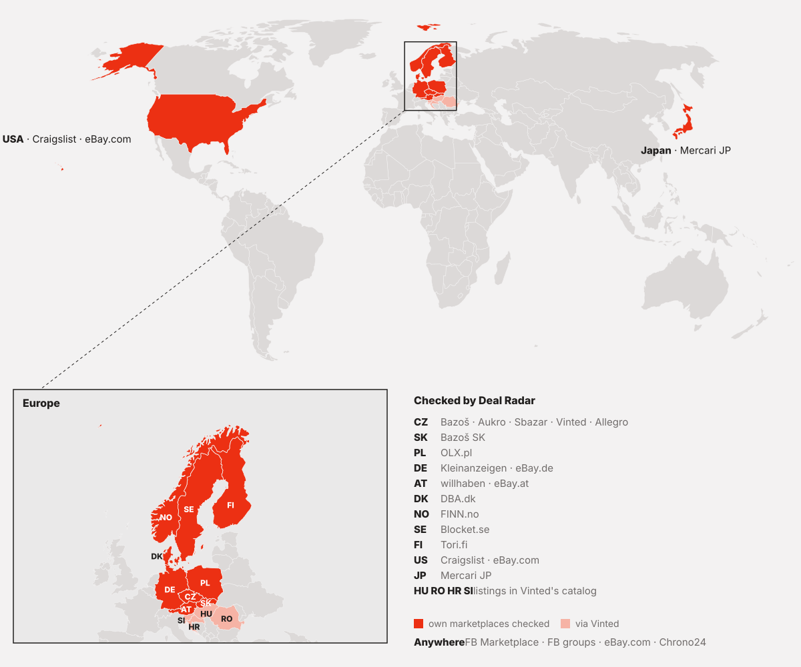
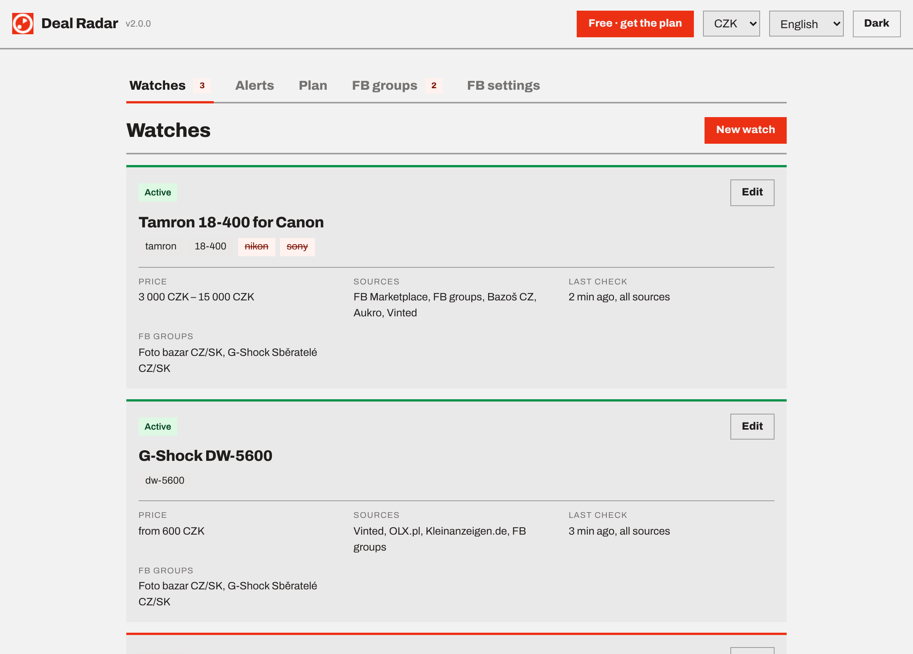
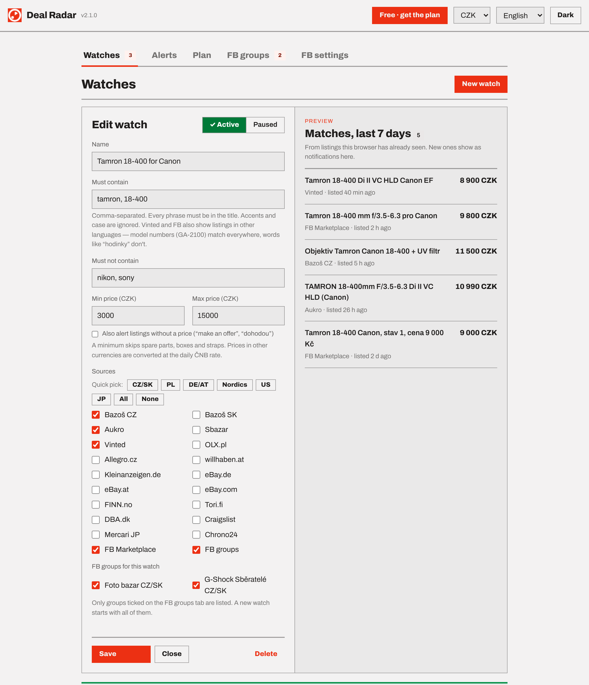
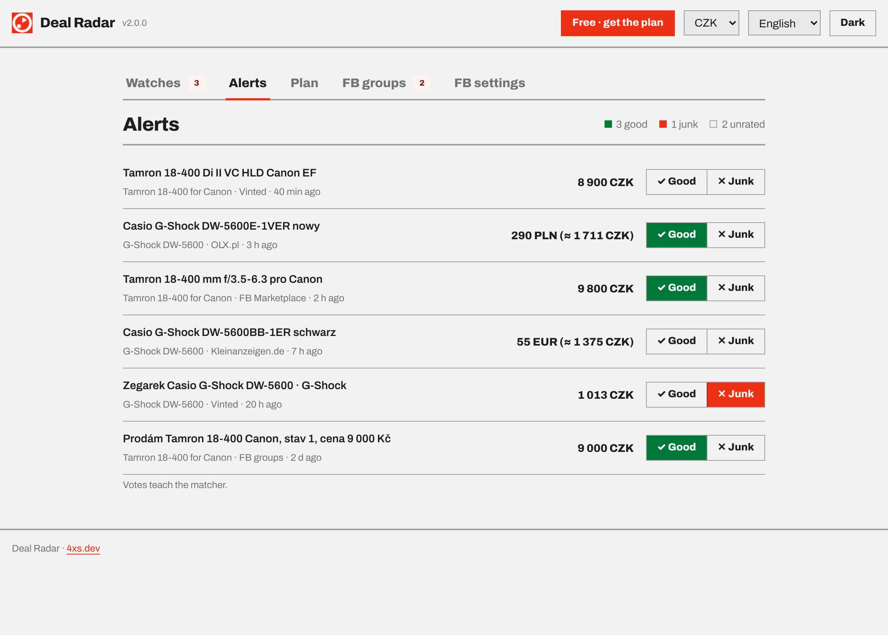
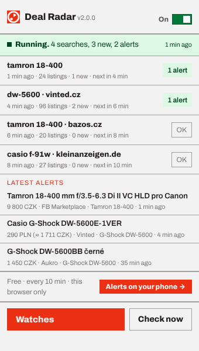
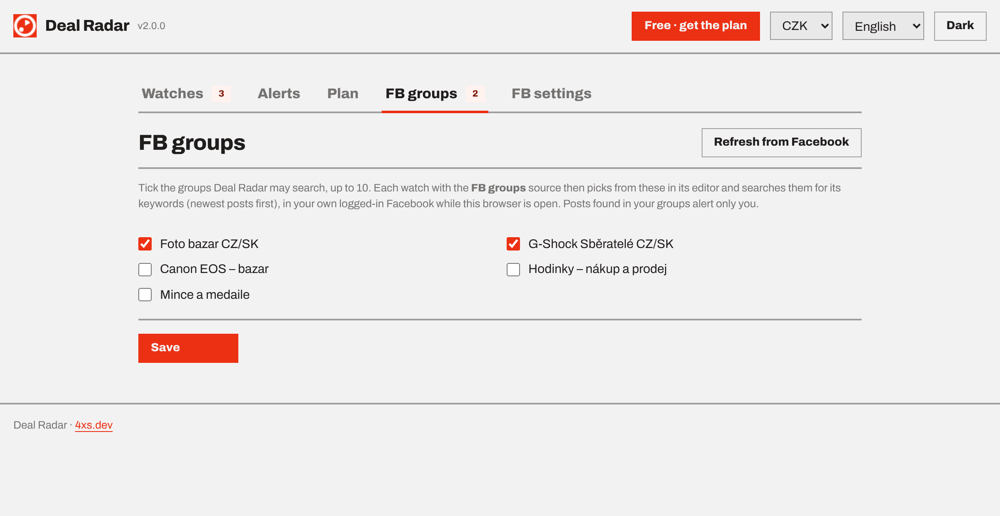
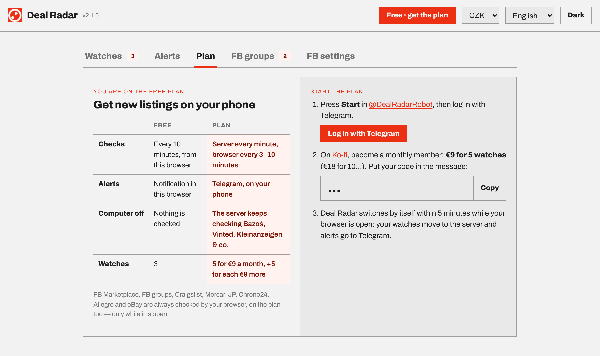

  

<h1 align="center">Deal Radar</h1>

<h1 align="center"><b>Be the first to message the seller.</b></h1> 

Deal Radar watches Facebook Marketplace and your Facebook groups — plus the top marketplaces in Czechia, Slovakia, Poland, Germany, Austria, Norway, Finland and Denmark, eBay.com and Craigslist in the US, Mercari in Japan and Chrono24 for watches — and tells you about a new listing before the deal is gone.

<b>Free in your browser.</b> The extension alone: 3 watches, checked every 10 minutes, notifications in the browser. 
<b>The plan, €9 a month for 5 watches:</b> Telegram alerts on your phone, the server checks every minute — also while your computer is off.

  <a href="https://radar.4xs.dev">radar.4xs.dev</a> · <a href="https://kotyzap.github.io/Deal-Radar/">project page</a> · <a href="https://radar.4xs.dev/privacy">privacy</a> · by <a href="https://4xs.dev">4xs.dev</a>

## Sources

"Server" sources are checked by the server every minute on the plan, and by your browser every 10 minutes for free. "Browser" sources are always checked by the extension, while your browser is open.

| Source | Country | Checked by |
|---|---|---|
| FB Marketplace | 🌎 | browser, around your location (default Prague + 500 km) |
| FB groups | 🌎 | browser, groups you joined |
| eBay.com | 🌎 | browser, US sellers only |
| Chrono24 | 🌎 | browser |
| Bazoš CZ |  | server |
| Aukro |  | server |
| Sbazar |  | server |
| Vinted |  | server; vinted.cz also lists items from Poland, Hungary, Romania, Croatia and Slovenia |
| Allegro.cz |  | browser |
| Bazoš SK |  | server |
| OLX.pl |  | server |
| Kleinanzeigen.de |  | server |
| eBay.de |  | browser |
| willhaben.at |  | server |
| eBay.at |  | browser |
| Craigslist |  | browser, up to 5 cities per watch |
| Mercari JP |  | browser; alerts add a Buyee link for buyers outside Japan |
| FINN.no |  | server |
| Tori.fi |  | server |
| DBA.dk |  | server |

<picture>
  <source media="(prefers-color-scheme: dark)" srcset="docs/img/coverage-dark.svg">
  
</picture>

<picture>
  <source media="(prefers-color-scheme: dark)" srcset="docs/img/watches-dark.png">
  
</picture>

## What's new

- **Deal Radar 2.1: a smoother start.** After you pay, the extension switches to the plan by itself within 5 minutes while your browser is open — no need to keep its Plan tab open. Logins renew themselves while you use Deal Radar (and if one is lost, a notification says so). New watches start with the sites of your country, with a quick pick for other regions; a watch with a price range can skip listings that have no price; watches can be exported to a file and imported in another browser. Error messages follow your language.
- **Safer alerts.** A listing an extension sends to the server must link to its own site (a Facebook item to facebook.com, an eBay item to ebay.de …), or it is dropped before anyone is alerted. A one-off Ko-fi payment never lowers your plan's watches.
- **Deal Radar 2.0: free in your browser.** No account, no invite: install the extension and add up to 3 watches. Every site — Bazoš, Vinted and Kleinanzeigen too — is checked from your own browser every 10 minutes, and new matches pop up as browser notifications. If your computer was off, one summary tells you how many matches came in meanwhile.
- **The plan: Telegram and the server, €9 a month for 5 watches** (+5 for every €9 more), as a Ko-fi membership with your DR-code. The server checks every minute, also while your computer is off; your browser checks FB Marketplace, Mercari JP, Allegro and eBay about every 3 minutes, Craigslist and Chrono24 every 5 and FB groups every 10; alerts land on your phone. Paying switches the extension over by itself and moves your watches to the server; when the plan ends they come back to the free mode. Bids, ranks and the wallet are gone — everyone hears at the same time.
- **Blocket.se dropped**, and with it the Mac mini helper that checked it.
- **One pause for everything.** The extension's pause switch stops all your searches and alerts, also those the server runs, until the time you picked or until you start again.
- **Allegro and eBay move to the browser extension.** Allegro.cz and eBay.de/.at/.com refuse every request that doesn't come from a real browser, so the server could no longer read them. The extension now checks them every ~3 minutes while your browser is open, like Chrono24. New watches leave them unticked.
- **From listing to alert.** radar.4xs.dev, the project page and this README show the path step by step, with a real Vinted alert. Vinted's catalog turns out to include Poland, Hungary, Romania, Croatia and Slovenia; the map shows them, and the editor suggests model numbers as keywords.
- **Coverage map.** The project page, radar.4xs.dev and this README show where Deal Radar looks: marketplaces in 10 countries (11 until Blocket left), plus FB, eBay.com and Chrono24 anywhere.
- **Nordics and Chrono24.** FINN.no, Tori.fi and DBA.dk are checked newest first, with prices in NOK, EUR and DKK. Chrono24 is checked by the browser extension.
- **Japan.** Mercari JP, checked by the browser extension (newest first, on sale only). Prices in JPY with your currency next to them. Mercari needs a Japanese phone number, so every Mercari alert also carries a Buyee link to buy from abroad.
- **USA.** eBay.com (US sellers) is checked by the server every minute, and Craigslist by the browser extension: pick up to 5 Craigslist areas per watch from Craigslist's own list (a town belongs to its nearest city's area — Leander is in *austin*). Prices in USD.
- **Pause switch.** One tap in the extension popup pauses Facebook and Craigslist checks for 1 h, 3 h or until you start again, and closes the pinned Facebook tab so your browser stays light. Server sources keep running.
- **Germany and Austria.** willhaben.at, Kleinanzeigen.de, eBay.de and eBay.at join the sources. Like Bazoš or OLX, the server checks them every minute, newest first.
- **Prices in your currency.** Pick CZK, EUR, PLN or USD. Alerts show the listing's own price and yours — “850 PLN (≈ 201 EUR)” — and you set a watch's min and max price in your currency.
- **Four languages.** The extension, radar.4xs.dev and the [project page](docs/index.html) speak English, Czech, German and Japanese. They follow your browser; switch in the header.

## From listing to alert

| | With Deal Radar | Checking by hand |
|---|---|---|
| **0:00** | A seller posts a G-Shock on Vinted. | |
| **1–3 min** | On the plan, Deal Radar's next check finds it — every minute on most sites, every 3 minutes on Vinted and Facebook (free: within 10–12 minutes). | |
| **+ seconds** | Telegram alert (free: a browser notification): title, price in your currency, link. | |
| **You** | Message the seller while the listing still says “listed a minute ago”. | Whenever you next refresh — often after someone else has already written. |

A real alert from 21 October (a Polish seller on Vinted, price converted to CZK; the listing said “listed a minute ago” when the alert was opened):

> **Casio G-Shock** 
> Zegarek Casio GShock WR 20Bar · G-Shock 
> 2 534 CZK · vinted 
> https://www.vinted.cz/items/…

| The server (plan) | Your browser |
|---|---|
| Every minute, your computer can be off: Bazoš, Aukro, Sbazar, Vinted, OLX, Kleinanzeigen, willhaben, FINN, Tori, DBA. Free: your browser checks these too, every 10 minutes. | The extension, while the browser is open: FB Marketplace, FB groups, Craigslist, Mercari JP, Chrono24, Allegro, eBay. |

Use model numbers as keywords (GA-2100, 18-400): Vinted and FB groups show listings in Polish, Hungarian, Romanian and more, and a model number matches in every language.

## How it works

1. **Install the extension** (Chrome; a Firefox build is experimental). Nothing to sign up for.
2. **Create a watch.** Keywords that must appear, keywords that must not, a minimum and maximum price in your currency — CZK, EUR, PLN or USD — the sources (a quick pick by country) and, for Facebook, the groups to search. With a price range you choose whether listings without a price ("make an offer") still alert. A 7-day preview shows what it would have caught. The first check of a search only learns what is listed now.
3. **Get the alert.** Free: a notification in your browser, every search checked every 10–12 minutes while the browser is open. With the plan: Telegram, within a minute for the server's sources.
4. **Vote Good or Junk.** One tap per alert tells the radar how well a watch is tuned.

**Starting the plan:** extension → **Plan** → press Start in @DealRadarRobot and log in with Telegram, then become a member on [Ko-fi](https://ko-fi.com/pavelk) (€9 a month for 5 watches) with your DR-code in the message. Within 5 minutes, while your browser is open, the extension switches over and moves your watches to the server — the Plan tab doesn't have to stay open.

<picture>
  <source media="(prefers-color-scheme: dark)" srcset="docs/img/editor-dark.png">
  
</picture>

*The editor: price range, sources, the watch's FB groups, and what it would have caught in the last 7 days.*

<picture>
  <source media="(prefers-color-scheme: dark)" srcset="docs/img/alerts-dark.png">
  
</picture>

*Alerts with prices, sources and Good / Junk votes. On the plan every alert also goes to Telegram.*

## Facebook Marketplace and groups, in your own browser

- **Browser extension.** FB has no public search API, so the extension checks your searches from your normal, logged-in Chrome or Firefox — one pinned tab, every ~3 minutes, newest first, Prague + 500 km.
- **Your FB groups.** Many deals are posted only in collector groups. On the FB groups tab you tick up to 10 groups you've joined; each watch then picks which of them to search. The extension runs Facebook's own search inside each group for the watch's keywords, newest posts first, about every 10 minutes.
- **Only offers, only for you.** A group post alerts only if it looks like an offer — a price or a sale word (prodám, na prodej, cenu nabídněte, sprzedam…) and no “wanted” word (koupím, hledám, kupię…). Group posts are private: they alert only the person whose browser found them and never go into the shared index.
- **Nothing leaves but listings.** Free: nothing leaves your browser at all. On the plan the extension pushes only the cards and posts it sees (title, price, link) to the radar. Your Facebook session stays in your browser.
- **On the plan, the other sources need no browser.** Bazoš, Aukro, Sbazar, Vinted, OLX.pl, willhaben.at, Kleinanzeigen.de, FINN, Tori and DBA are polled by the server itself, so alerts keep coming when your computer is off.

 

<picture>
  <source media="(prefers-color-scheme: dark)" srcset="docs/img/groups-dark.png">
  
</picture>

*FB groups tab: tick the groups Deal Radar may search; each watch picks from these.*

## Pricing

| | Free | Plan |
|---|---|---|
| **Checks** | every 10 minutes, from your browser | server every minute; browser: FB Marketplace, Mercari JP, Allegro, eBay ~3 min, Craigslist, Chrono24 ~5 min, FB groups ~10 min |
| **Alerts** | notification in your browser | Telegram, on your phone |
| **Computer off** | nothing is checked | the server keeps checking its sources |
| **Watches** | 3 | 5 for €9 a month, +5 for every €9 more |

The plan is a monthly membership on [Ko-fi](https://ko-fi.com/pavelk) with your personal DR-code in the first message; renewals are matched by your Ko-fi e-mail. A one-off payment adds a month (you get a reminder 3 days before it ends) and never lowers the number of watches you have; the membership tier sets it, so changing the tier is how a plan grows or shrinks. FB, FB groups, Craigslist, Mercari JP, Chrono24, Allegro and eBay are always checked by your browser, on the plan too.

<picture>
  <source media="(prefers-color-scheme: dark)" srcset="docs/img/plan-dark.png">
  
</picture>

## Status

2.1.0. Built on Cloudflare Workers + D1, Telegram Login and a Chrome extension (the Firefox build is generated on every deploy but not yet tested in Firefox).

The Chrome Web Store listing is unlisted and waiting for approval; the install link goes up on [radar.4xs.dev](https://radar.4xs.dev) once it is approved.

Deal Radar is an independent project and is not affiliated with Meta/Facebook, eBay, Allegro, Vinted, Craigslist, Mercari, Chrono24, Telegram or any other marketplace it searches.

---

© Pavel Kotyza · [4xs.dev](https://4xs.dev)
