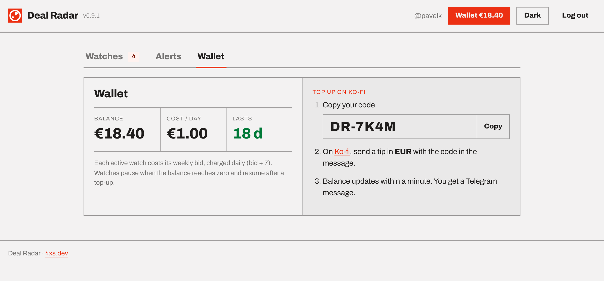

<p align="center">
  
</p>

<h1 align="center">Deal Radar</h1>

<h1 align="center"><b>Be the first to message the seller.</b></h1><br>
<p align="center">Deal Radar watches Czech, Slovak and EU marketplaces for the things you collect and pings you on Telegram within a minute of a new listing — before the deal is gone.</p>

<p align="center">
  <a href="https://radar.4xs.dev">radar.4xs.dev</a> · <a href="CHANGELOG.md">Changelog</a> · <a href="API.md">API</a> · by <a href="https://4xs.dev">4xs.dev</a>
</p>

**Sources:** Bazoš CZ · Bazoš SK · Aukro · Sbazar · Vinted · OLX.pl · Allegro.cz · FB Marketplace

<picture>
  <source media="(prefers-color-scheme: dark)" srcset="docs/img/watches-dark.png">
  
</picture>

## How it works

1. **Log in with Telegram.** No password, no e-mail. Alerts arrive in the same Telegram account.
2. **Create a watch.** Keywords that must appear, keywords that must not, a price ceiling in CZK (listings in EUR or PLN are converted at the daily ČNB rate), and the sources to watch. A 7-day preview shows what it would have caught.
3. **Get the alert.** Every source is polled once a minute. A new listing that matches lands in Telegram with title, price and link — you message the seller.
4. **Vote Good or Junk.** One tap per alert tells the radar how well a watch is tuned.

<picture>
  <source media="(prefers-color-scheme: dark)" srcset="docs/img/editor-dark.png">
  
</picture>

*The editor shows what the watch would have caught in the last 7 days.*

<picture>
  <source media="(prefers-color-scheme: dark)" srcset="docs/img/alerts-dark.png">
  
</picture>

*Every alert also goes to Telegram. “#1 of 3” = you heard first among three bidders.*

## Facebook Marketplace, in your own browser


- **Browser extension.** FB has no public search API, so the extension checks your searches from your normal, logged-in Chrome or Firefox — one pinned tab, every ~3 minutes, newest first, Prague + 500 km.
- **Nothing leaves but listings.** The extension pushes only the cards it sees (title, price, link) to the radar. Your Facebook session stays in your browser.
- **Other sources need no extension.** Bazoš, Aukro, Sbazar, Vinted, OLX.pl and Allegro.cz are polled by the server itself, so alerts keep coming when your computer is off.

<br clear="right">

## Pricing

| | |
|---|---|
| **7 days free trial** | Every account starts with a week of unlimited watches. |
| **from €2 per watch per week** | Each active watch costs its weekly bid, charged daily from a wallet you top up on [Ko-fi](https://ko-fi.com/pavelk) with your personal DR-code. |
| **Bid to hear first** | When one listing matches several people's watches, the highest bid is alerted first; each next place a minute later. Alerts show your rank and the top rival bid. |

<picture>
  <source media="(prefers-color-scheme: dark)" srcset="docs/img/wallet-dark.png">
  
</picture>

## Status

Private pilot — login is by invite. Built on Cloudflare Workers + D1, Telegram Login and a Chrome/Firefox extension.

## Development

Requires Node.js and [Wrangler](https://developers.cloudflare.com/workers/wrangler/) (installed as a dev dependency).

```bash
npm install
npm run db:local      # create the local D1 database (schema + migrations)
npm run dev           # Worker on http://localhost:8787
npm test              # smoke tests
npm run test:watcher  # parser + FX unit tests
npm run watch         # optional Mac-side watcher (watcher/watcher.mjs)
```

Secrets go in `.dev.vars` (not committed).

| Path | What |
|---|---|
| `src/` | Cloudflare Worker (API, cron polling, Telegram, billing) |
| `extension/` | Chrome/Firefox extension (FB Marketplace & groups) |
| `watcher/` | Source parsers, shared with the optional local watcher |
| `migrations/`, `schema.sql` | D1 schema |
| `docs/` | Landing page and screenshots |

---

© Pavel Kotyza · [4xs.dev](https://4xs.dev)
